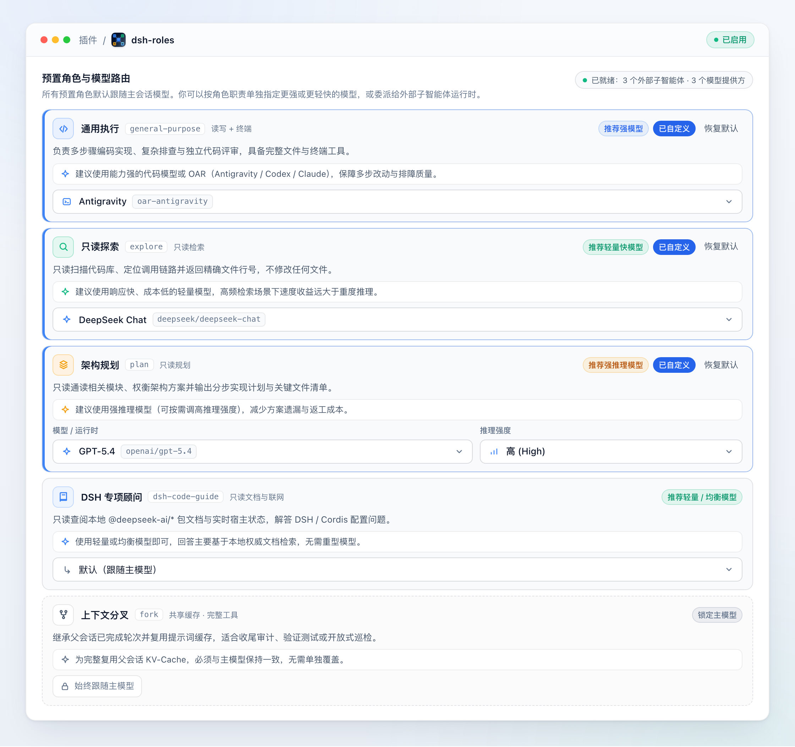

<div align="center">
  

  <h1>dsh-roles</h1>

  <p>
    <strong>面向 <a href="https://www.deepseek.com/harness/">DeepSeek Harness</a> 的子智能体角色编排插件。</strong><br>
    按角色隔离上下文与工具权限，提供可视化模型与外部运行时路由、步数预算与并行写入护栏。
  </p>

  <p>
    <a href="https://www.npmjs.com/package/dsh-roles"></a>
    
    <a href="https://github.com/myth929/dsh-roles/blob/main/LICENSE"></a>
  </p>

  <p>
    <a href="https://github.com/myth929/dsh-roles/blob/main/README.md">English</a> · <strong>简体中文</strong>
  </p>
</div>

<p align="center">
  
  <br>
  <sub><code>插件 → dsh-roles</code> — 为不同角色独立指定 LLM 模型或外部子智能体运行时，保存即时生效。</sub>
</p>

`dsh-roles` 将子智能体委派统一收敛为单一工具 `orchestrate_subagent`，对齐 Claude Code 的角色分层设计。内部预设会自动从用户预设选择器中隐藏，原始的 `subagent` / `subagent_fork` / `subagent_oar` 工具会自动收敛至 `orchestrate_subagent`。

---

## 安装与更新

- **Web / 桌面端**：打开 **Plugins → Add plugin**，搜索 `dsh-roles` 并点击 **Install**。
- **CLI**：

```sh
dsh plugin add dsh-roles          # 或直接从 GitHub 安装：dsh plugin add myth929/dsh-roles
dsh plugin update dsh-roles@latest
```

## 角色体系

| 角色 | 适用场景 | 能力与默认策略 |
| --- | --- | --- |
| `general-purpose` *（默认）* | 多步骤编码、排查与代码评审 | 完整工具（`read`、`write`、`edit`、`glob`、`grep`、`bash`/`pwsh`、`jobs`、`todo`）；保留 `AGENTS.md`；支持 `background`、`readOnly`、`writeScope`、`isolation: "worktree"` 与 `includeMcp` |
| `explore` | 快速只读代码库检索 | `read`、`glob`、`grep`；剥离工作区指令与技能目录；紧凑裁剪输出，返回 `Key Files` |
| `plan` | 只读架构与实现规划 | `read`、`glob`、`grep`；剥离工作区指令与技能目录；返回 `Critical Files for Implementation` |
| `fork` | 共享上下文的审计与验证 | 继承父会话已完成轮次、模型与提示词缓存，保留完整父工具权限，禁止嵌套委派 |
| `dsh-code-guide` | DSH / Cordis 专项顾问 | 只读文档、联网与 `cordis_inspect_*`；自动注入本地 `@deepseek-ai/*` 文档路径与宿主摘要 |

## 配置说明

默认零配置即可开箱使用（所有角色跟随主会话模型）。  
优先级：**Web UI / Loader 配置 > 环境变量 > 默认值**。

### Web UI 可视化配置

在 **Plugins → dsh-roles** 中可为各可配置角色（`general-purpose`、`explore`、`plan`、`dsh-code-guide`）指定 LLM 模型（含可选推理强度 `reasoningEffort`）或外部子智能体运行时（`oar-antigravity`、`oar-codex`、`oar-claude`、`codex` 等），保存后即时生效，无需重启。`fork` 为复用提示词缓存始终跟随主模型。

### 环境变量

| 配置项 / 环境变量 | 默认值 | 说明 |
| --- | --- | --- |
| `models` / `DSH_ROLES_MODELS` | 跟随主模型 | 按角色路由配置：`"provider/model"` 或 `{ provider, model, reasoningEffort, subagentProvider }`（不可覆盖 `fork`） |
| `budgets` / `DSH_ROLES_BUDGETS` | `general-purpose: 8/16/28`，`explore`/`dsh-code-guide: 4/8/14`，`plan`/`fork: 5/10/18` | 按角色配置 `quick` / `standard` / `thorough` 步数预算（整数 `2..200`） |
| `reminders` / `DSH_ROLES_REMINDERS` | `{ nudgeInspectionSteps: 3, maxNudges: 3, catalogRefreshTurns: 3 }` | 轮内委派提醒节奏（`nudgeInspectionSteps` `1..50`、`maxNudges` `0..20`）与角色目录周期刷新间隔（`catalogRefreshTurns` `0..50`） |

```sh
DSH_ROLES_MODELS='{"explore":"deepseek/deepseek-chat","plan":{"provider":"openai","model":"gpt-5.4","reasoningEffort":"high"},"general-purpose":{"subagentProvider":"oar-antigravity"}}'
DSH_ROLES_BUDGETS='{"explore":{"quick":3},"general-purpose":{"standard":20}}'
DSH_ROLES_REMINDERS='{"nudgeInspectionSteps":4,"maxNudges":2,"catalogRefreshTurns":3}'
```

### 外部子智能体运行时（OAR）

- **Codex / Claude Code**：在 DSH Profile 中安装并配置官方插件 `@deepseek-ai/dsh-experimental-subagent-oar`（完成原生 CLI 登录），或安装独立子智能体插件（如 `@deepseek-ai/dsh-subagent-codex`、`@deepseek-ai/dsh-subagent-claude-code`），`dsh-roles` 会自动发现。
- **Antigravity（`oar-antigravity`）**：检测到本机安装 `agy`（`>= 1.5.0`）时自动注册内置回退提供方；配置官方 OAR 插件后自动让位。仅当用户显式将角色路由到 `oar-antigravity` 时才会触发调用，并以 `agy acp --dangerously-skip-permissions` 非交互自动授权模式运行。

## 安全护栏

- **步数预算收敛** — 到达预算最后一步时自动禁用工具以实现干净收敛，超限时保留已有非空输出并标记为 `budget-exhausted`。
- **三层并发与写入保护**：
  - `readOnly: true` — 跳过写锁并禁用 `write`/`edit`/`apply_patch`，适合并行审查与排查（保留 `bash` 与可选 MCP）。
  - `writeScope` — 主工作区并行写入须声明互不重叠的路径前缀（本地执行校验 `write`/`edit`/`apply_patch`，基准目录锚定在子智能体初始工作区）。
  - `isolation: "worktree"` — 结合 `@deepseek-ai/dsh-experimental-worktree` 在独立 Git worktree 中并行修改，自动清理空改动分支并提交已完成改动供主 Agent 审查合入（同步调用会直接返回分支与 diff 汇总；`background: true` 在后台异步收尾）。
- **单层委派限制** — 固定单层（`root → child`）委派深度（含 `fork`，冷恢复后仍生效）。

## 参与共建

欢迎通过 [Issues](https://github.com/myth929/dsh-roles/issues) 反馈问题或提交 Pull Request。

```sh
git clone https://github.com/myth929/dsh-roles.git
cd dsh-roles
pnpm install
dsh plugin add /path/to/dsh-roles   # 本地软链到 DSH Profile
```

提交 PR 前请确认 `pnpm run build && pnpm run typecheck && pnpm test` 通过（需 Node.js `>=24` 与 `pnpm`）。若修改了 `cordis.patch.yml`，需同步更新 `peerDependencies`（单测会自动校验）；涉及功能或界面变更时请同步更新中英文 README（以及 `locale/*.json` 与 `src/client/locales.ts`）。编排策略改动可通过 `pnpm run benchmark:report` 或 `pnpm run benchmark:live` 辅助验证。

## 许可证

[MIT](https://github.com/myth929/dsh-roles/blob/main/LICENSE)
